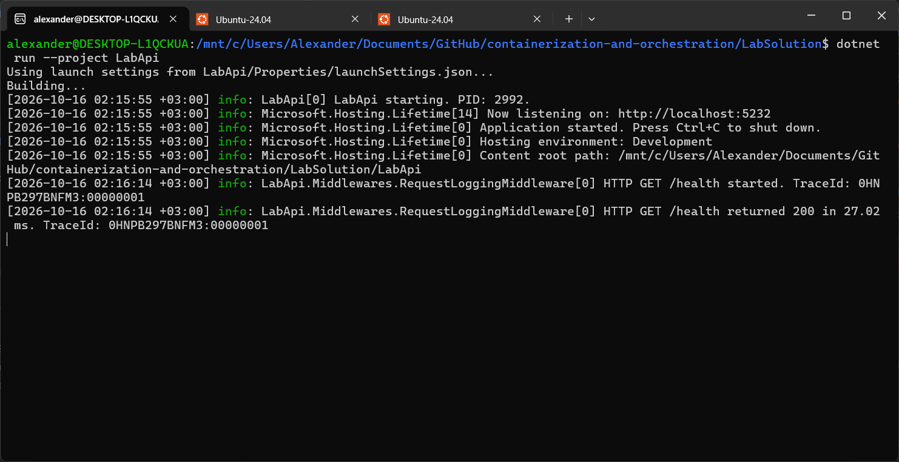
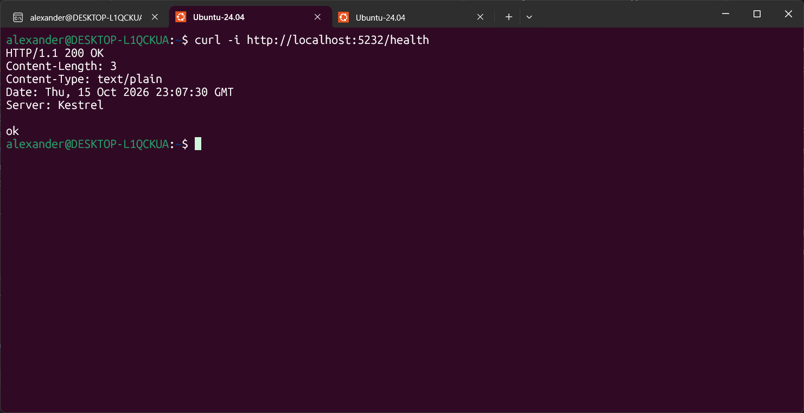
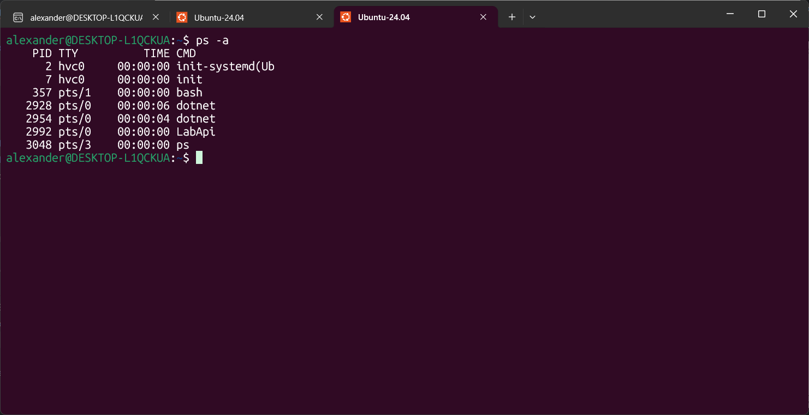
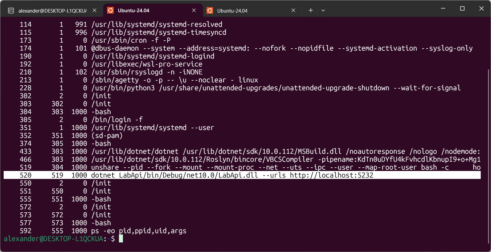
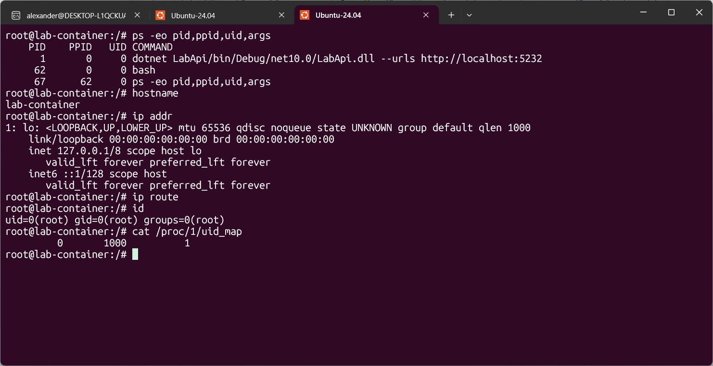
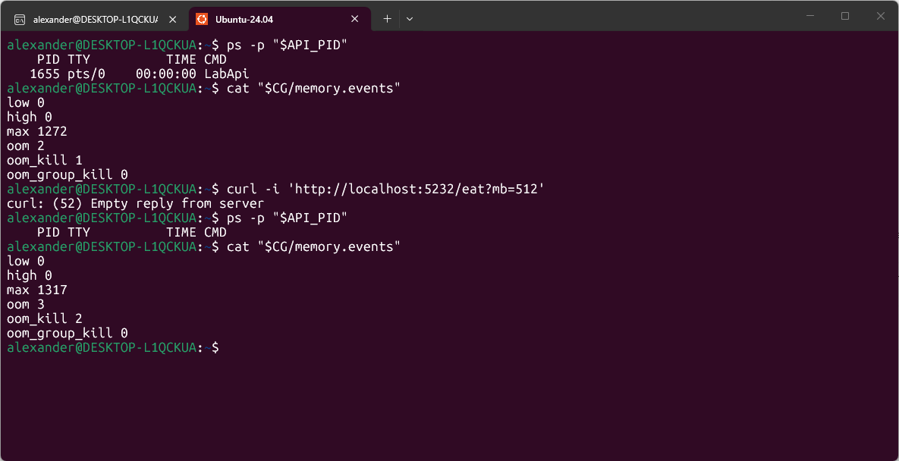
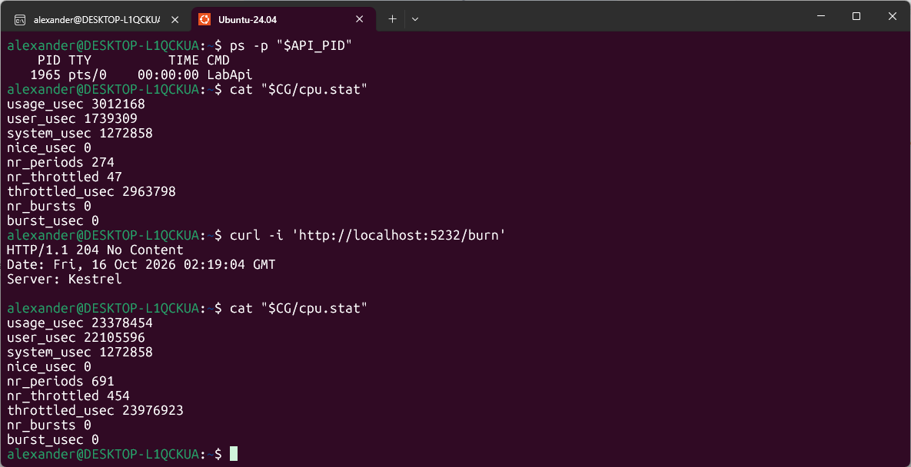
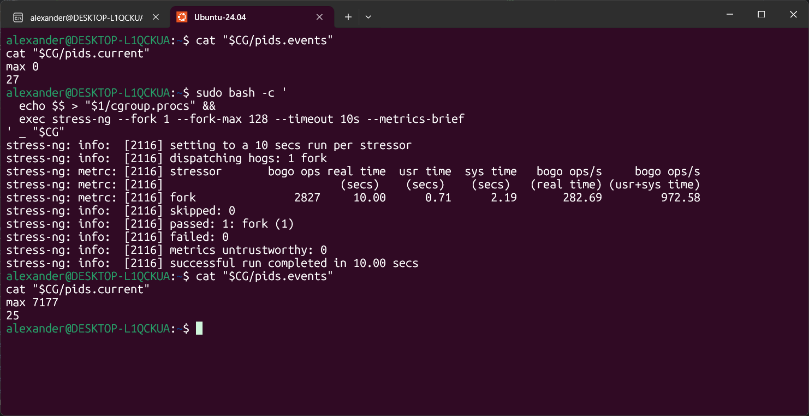

# Лаба 1 — Свой Docker

## Часть 0 — Свой сервис
Кодовая база для всех лабораторных работ расположена в [LabSolution](../LabSolution).

В рамках текущей лабораторной работы реализован http-сервис `api` на C# c тремя эндпоинтами:
* `GET /health` — возвращает `ok`;
* `GET /eat?mb=N` — выделяет `N` мегабайт памяти и держит их;
* `GET /burn` — нагружает одно ядро CPU в бесконечном цикле.

## Часть 1 — Запусти напрямую

Открываем `LabSolution` и выполняем `dotnet run --project LabApi` (сборка `LabApi.csproj` и запуск).


Делаем запрос `/health`.


Находим PID процесса — **2992** (на первом скрине в логах тоже можно найти).


## Часть 2 — namespaces
Ранее запускали апи одной командой `dotnet run --project LabApi`. Теперь отдельно соберём апи командой `dotnet build LabApi` и получим `LabApi.dll`

Далее изолированно (изолируем видимость) меняем имя хоста, поднимаем интерфейс `lo` и запускаем апи командой:

```bash
unshare \
  --pid --fork \
  --mount --mount-proc \
  --net \
  --uts \
  --ipc \
  --user --map-root-user \
  bash -c '
    hostname lab-container &&
    ip link set lo up &&
    exec dotnet LabApi/bin/Debug/net10.0/LabApi.dll --urls http://localhost:5232
  '
```

Команда изолирует шесть пространств имён:
* `pid` — API получает PID 1 и не видит процессы вне своего namespace;
* `mount` — создаётся отдельная таблица монтирований и свой `/proc`; файлы хоста остаются доступны;
* `net` — интерфейсы и маршруты хоста недоступны, внутри есть только включённый `lo`;
* `uts` — внутри используется своё имя хоста `lab-container`;
* `ipc` — изолированы System V IPC и очереди сообщений POSIX;
* `user` — root внутри соответствует обычному пользователю снаружи и не получает права root на хосте.

Процесс апи снаружи пространства имеет: PID 520, PPID 519 и UID 1000.


Заходим внутрь через `sudo nsenter --target 520 --pid --mount --net --uts --ipc --user bash`.

Тот же процесс внутри имеет: PID 1, PPID 0 и UID 0. Также внутри не видно сторонних процессов, другое имя хоста, в сети только `lo` и UID 0, которому принадлежит процесс, снаружи соответствует UID 1000. Изоляция видимости действительно есть.


## Часть 3 — cgroups
Смотрим какие контроллеры доступны в корневой группе и какие включены для дочерних групп:

```bash
cat /sys/fs/cgroup/cgroup.controllers     # cpuset cpu io memory hugetlb pids rdma
cat /sys/fs/cgroup/cgroup.subtree_control # cpu memory pids
```

Необходимые контроллеры уже включены. Повторяем команду включения, чтобы последовательность действий не зависела от начального состояния системы:
```bash
echo '+cpu +memory +pids' | sudo tee /sys/fs/cgroup/cgroup.subtree_control
```

Создаём cgroup `lab-api` и добавляем лимиты на memory — 256 МиБ, cpu — половина ядра, pids — 64 задачи (процессы и потоки) и запрещаем swap данных:

```bash
CG=/sys/fs/cgroup/lab-api
sudo mkdir -p "$CG"

echo 268435456 | sudo tee "$CG/memory.max"
echo '50000 100000' | sudo tee "$CG/cpu.max"
echo 64 | sudo tee "$CG/pids.max"

echo 0 | sudo tee "$CG/memory.swap.max"
```

Запускаем наше апи как в части 1, узнаём его PID и помещаем в созданную группу:

```bash
API_PID=1655
echo "$API_PID" | sudo tee "$CG/cgroup.procs"
```

Шлём запрос `/eat?mb=512` (512 > 256) и наблюдаем, что процесс умер и показатели `oom` и `oom_kill` увеличиваются.


Как в прошлый раз запускаем апи, обновляем `API_PID`, помещаем в группу, отправляем запрос `/burn` и наблюдаем throttling (изменение показателей `nr_throttled` и `throttled_usec`).


Запускаем форк-бомбу командой: 
```bash
sudo bash -c '
  echo $$ > "$1/cgroup.procs" &&
  exec stress-ng --fork 1 --fork-max 128 --timeout 10s --metrics-brief
' _ "$CG"
```

Видим, что ядро 7177 раз отказало в создании новой задачи.


## Часть 4 — права

## Часть 5 — Собери свой Docker

## Часть 6 — Образы

## Часть 7 — Когда контейнера мало

## Часть 8 — Мониторинг
