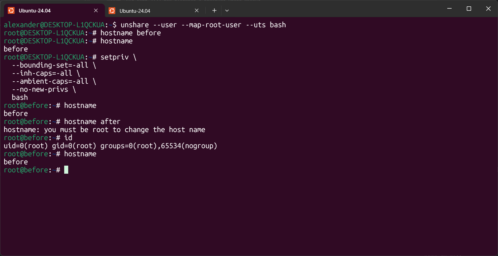
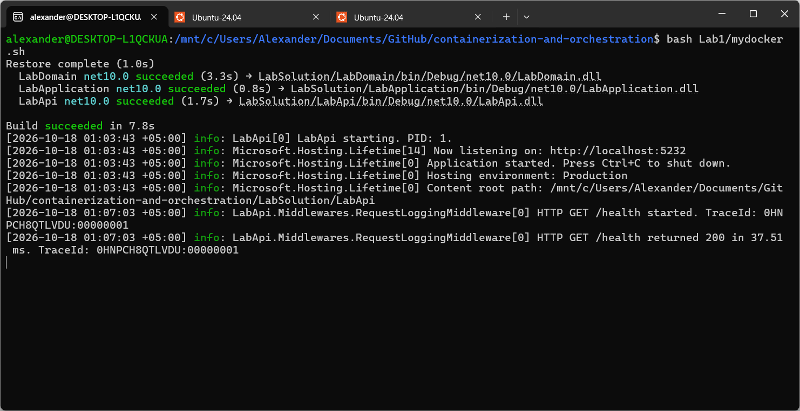
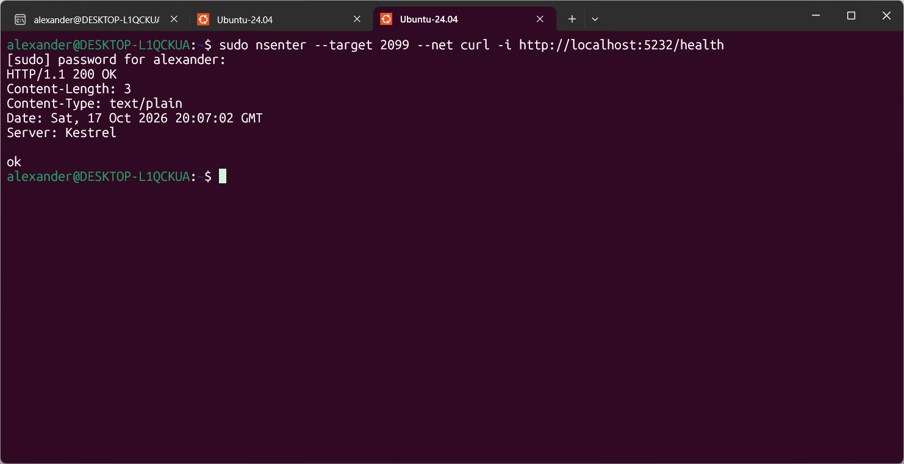
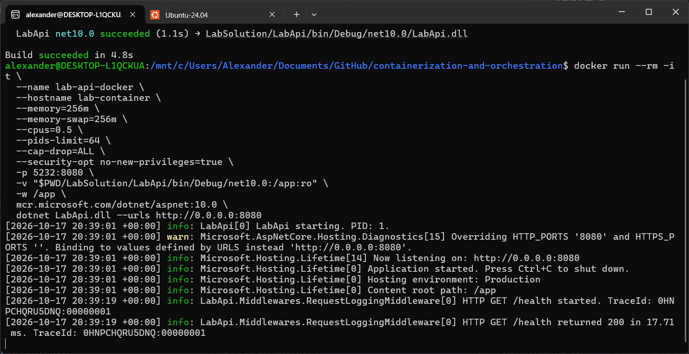
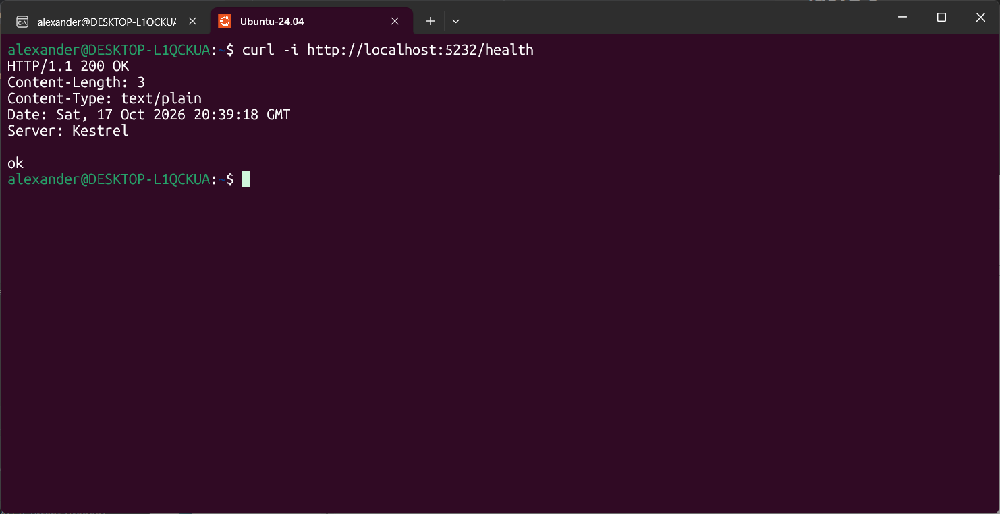
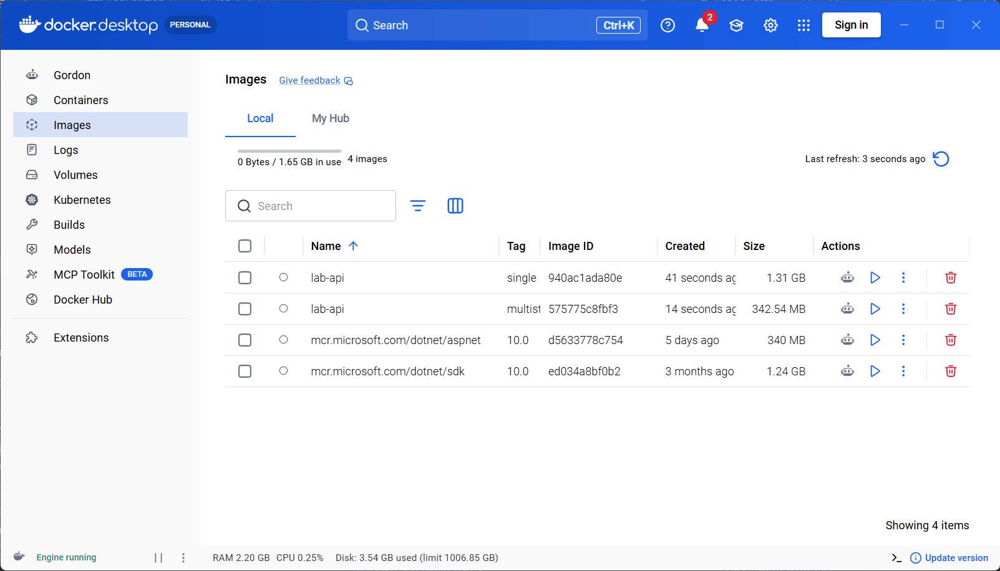
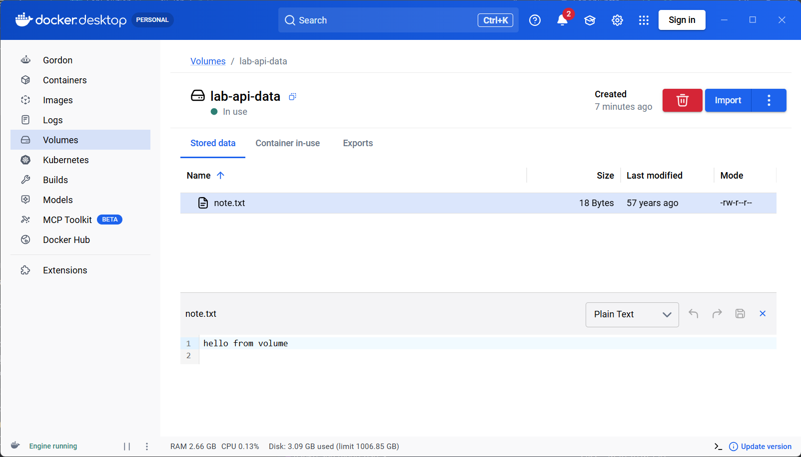

# Лаба 1 — Свой Docker

## Часть 0 — Свой сервис
Кодовая база для всех лабораторных работ расположена в [LabSolution](../LabSolution).

В рамках текущей лабораторной работы реализован http-сервис `api` на C# c тремя эндпоинтами:
* `GET /health` — возвращает `ok`;
* `GET /eat?mb=N` — выделяет `N` мегабайт памяти и держит их;
* `GET /burn` — нагружает одно ядро CPU в бесконечном цикле.

## Часть 1 — Запусти напрямую

Открываем `LabSolution` и выполняем `dotnet run --project LabApi` (сборка `LabApi.csproj` и запуск).


Делаем запрос `/health`.


Находим PID процесса — **2992** (на первом скрине в логах тоже можно найти).


## Часть 2 — namespaces
Ранее запускали апи одной командой `dotnet run --project LabApi`. Теперь отдельно соберём апи командой `dotnet build LabApi` и получим `LabApi.dll`

Далее изолированно (изолируем видимость) меняем имя хоста, поднимаем интерфейс `lo` и запускаем апи командой:

```bash
unshare \
  --pid --fork \
  --mount --mount-proc \
  --net \
  --uts \
  --ipc \
  --user --map-root-user \
  bash -c '
    hostname lab-container &&
    ip link set lo up &&
    exec dotnet LabApi/bin/Debug/net10.0/LabApi.dll --urls http://localhost:5232
  '
```

Команда изолирует шесть пространств имён:
* `pid` — API получает PID 1 и не видит процессы вне своего namespace;
* `mount` — создаётся отдельная таблица монтирований и свой `/proc`; файлы хоста остаются доступны;
* `net` — интерфейсы и маршруты хоста недоступны, внутри есть только включённый `lo`;
* `uts` — внутри используется своё имя хоста `lab-container`;
* `ipc` — изолированы System V IPC и очереди сообщений POSIX;
* `user` — root внутри соответствует обычному пользователю снаружи и не получает права root на хосте.

Процесс апи снаружи пространства имеет: PID 520, PPID 519 и UID 1000.


Заходим внутрь через `sudo nsenter --target 520 --pid --mount --net --uts --ipc --user bash`.

Тот же процесс внутри имеет: PID 1, PPID 0 и UID 0. Также внутри не видно сторонних процессов, другое имя хоста, в сети только `lo` и UID 0, которому принадлежит процесс, снаружи соответствует UID 1000. Изоляция видимости действительно есть.


## Часть 3 — cgroups
Смотрим какие контроллеры доступны в корневой группе и какие включены для дочерних групп:

```bash
cat /sys/fs/cgroup/cgroup.controllers     # cpuset cpu io memory hugetlb pids rdma
cat /sys/fs/cgroup/cgroup.subtree_control # cpu memory pids
```

Необходимые контроллеры уже включены. Повторяем команду включения, чтобы последовательность действий не зависела от начального состояния системы:
```bash
echo '+cpu +memory +pids' | sudo tee /sys/fs/cgroup/cgroup.subtree_control
```

Создаём cgroup `lab-api` и добавляем лимиты на memory — 256 МиБ, cpu — половина ядра, pids — 64 задачи (процессы и потоки) и запрещаем swap данных:

```bash
CG=/sys/fs/cgroup/lab-api
sudo mkdir -p "$CG"

echo 268435456 | sudo tee "$CG/memory.max"
echo '50000 100000' | sudo tee "$CG/cpu.max"
echo 64 | sudo tee "$CG/pids.max"

echo 0 | sudo tee "$CG/memory.swap.max"
```

Запускаем наше апи как в части 1, узнаём его PID и помещаем в созданную группу:

```bash
API_PID=1655
echo "$API_PID" | sudo tee "$CG/cgroup.procs"
```

Шлём запрос `/eat?mb=512` (512 > 256) и наблюдаем, что процесс умер и показатели `oom` и `oom_kill` увеличиваются.


Как в прошлый раз запускаем апи, обновляем `API_PID`, помещаем в группу, отправляем запрос `/burn` и наблюдаем throttling (изменение показателей `nr_throttled` и `throttled_usec`).


Запускаем форк-бомбу командой: 
```bash
sudo bash -c '
  echo $$ > "$1/cgroup.procs" &&
  exec stress-ng --fork 1 --fork-max 128 --timeout 10s --metrics-brief
' _ "$CG"
```

Видим, что ядро 7177 раз отказало в создании новой задачи.


## Часть 4 — права
Следующая команда запускает оболочку без capabilities и запрещает повышение привилегий при выполнении других программ:
```bash
setpriv \
  --bounding-set=-all \
  --inh-caps=-all \
  --ambient-caps=-all \
  --no-new-privs \
  bash
```

Создаём неймспейсы `user` и `uts`, запускаем урезанную оболочку, пробуем изменить имя хоста и убеждаемся, что этого сделать нельзя.


Проверяем создание каталога без ограничений, затем загружаем готовый профиль [seccomp-no-mkdir.bpf](seccomp-no-mkdir.bpf), запрещающий `mkdir` и `mkdirat` с ошибкой `EPERM`.

```text
alexander@DESKTOP-L1QCKUA:~$ export SECCOMP_TEST_DIR="$(mktemp -d)"
mkdir "$SECCOMP_TEST_DIR/probe"
rmdir "$SECCOMP_TEST_DIR/probe"

setpriv --no-new-privs --seccomp-filter ./seccomp-no-mkdir.bpf \
  bash --noprofile --norc
bash-5.2$ grep -E '^(NoNewPrivs|Seccomp)' /proc/$$/status
mkdir "$SECCOMP_TEST_DIR/probe"
NoNewPrivs:     1
Seccomp:        2
Seccomp_filters:        1
mkdir: cannot create directory ‘/tmp/tmp.K6wtiRZgfW/probe’: Operation not permitted
bash-5.2$ exit
mkdir "$SECCOMP_TEST_DIR/probe"
exit
alexander@DESKTOP-L1QCKUA:~$
```

`NoNewPrivs: 1` подтверждает запрет повышения привилегий, `Seccomp: 2` — режим фильтрации, `Seccomp_filters: 1` — наличие одного фильтра. Под фильтром каталог не создаётся, после выхода в исходную оболочку — создаётся. Дочерние процессы наследуют фильтр, `exec` его не снимает. Файл `seccomp-no-mkdir.bpf` содержит учебный профиль, запрещающий только создание каталогов через `mkdir` и `mkdirat`.

Capabilities ограничивают право выполнять административные операции. После сброса CAP_SYS_ADMIN изменение имени хоста запрещено, хотя UID остаётся равным 0.
Seccomp ограничивает доступные системные вызовы. Здесь запрет возвращает `EPERM`, не завершая процесс.

## Часть 5 — Собери свой Docker
Объединили namespaces, cgroup-лимиты и сброс capabilities в один скрипт [mydocker.sh](mydocker.sh), который запускает апи. Скрипт запускатеся из корня репозитория. Запускаем наш скрипт и шлём запрос. По логам видно, что запрос пришёл и был обработан.





Запускаем апи через докер, предварительно собрав его:
```bash
dotnet build LabSolution/LabApi --configuration Debug

docker run --rm -it \
  --name lab-api-docker \
  --hostname lab-container \
  --memory=256m \
  --memory-swap=256m \
  --cpus=0.5 \
  --pids-limit=64 \
  --cap-drop=ALL \
  --security-opt no-new-privileges=true \
  -p 5232:8080 \
  -v "$PWD/LabSolution/LabApi/bin/Debug/net10.0:/app:ro" \
  -w /app \
  mcr.microsoft.com/dotnet/aspnet:10.0 \
  dotnet LabApi.dll --urls http://0.0.0.0:8080
```





Оба способа запуска используют namespaces и cgroups, задают одинаковые лимиты памяти, CPU и количества задач, сбрасывают capabilities и запрещают повышение привилегий. API работает как PID 1 и отвечает на `/health`. В скрипте применяется seccomp-профиль с запретом `mkdir` и `mkdirat`, а Docker использует стандартный профиль с другим набором правил. Скрипт явно создаёт user namespace с сопоставлением обычного пользователя с root внутри; команда Docker аналогичное сопоставление не задаёт.

Docker дополнительно предоставляет корневую файловую систему из образа, настраивает сеть и публикацию порта, управляет контейнером и удаляет его после завершения благодаря `--rm`. Наш скрипт использует файловую систему хоста, оставляет в сети только `lo` и требует `nsenter` для запроса к API; cgroup после остановки остаётся. В показанном запуске Docker среда ASP.NET берётся из образа, а собранное приложение подключается с хоста через bind mount.

По логам также видно различие часовых поясов: при запуске скрипта используется смещение `+05:00`, а в Docker — `+00:00` (UTC). Это настройка окружения контейнера; часовой пояс хоста не меняется.

## Часть 6 — Образы
Создаём два Dockerfile: [DockerfileSingle](../LabSolution/LabApi/DockerfileSingle) и [DockerfileMultiStage](../LabSolution/LabApi/DockerfileMultiStage).

Собираем образы из корня репозитория:
```bash
docker build -t lab-api:single \
  -f LabSolution/LabApi/DockerfileSingle LabSolution
  
docker build -t lab-api:multistage \
  -f LabSolution/LabApi/DockerfileMultiStage LabSolution
```

Получились такие образы:


Single весит 1,31 ГБ — примерно на 0,07 ГБ больше базового образа `mcr.microsoft.com/dotnet/sdk:10.0`, который весит 1,24 ГБ и содержит SDK и среду выполнения. Дополнительные 0,07 ГБ занимают наше приложение, исходники, NuGet-пакеты и промежуточные файлы сборки. Число слоёв — 33.

Multistage весит около 342 МБ, что значительно меньше single и примерно на 2 МБ больше базового образа `mcr.microsoft.com/dotnet/aspnet:10.0`. Базовый образ весит 340 МБ и содержит среду выполнения веб-приложений. Дополнительное место занимают опубликованные файлы нашего приложения. Число слоёв — 19.

При сборке образа multistage после образа single из кэша переиспользовались следующие шаги:
```text
 => CACHED [build  2/10] WORKDIR /src                                                                              0.0s
 => CACHED [build  3/10] COPY [Directory.Packages.props, ./]                                                       0.0s
 => CACHED [build  4/10] COPY [LabApi/LabApi.csproj, LabApi/]                                                      0.0s
 => CACHED [build  5/10] COPY [LabApplication/LabApplication.csproj, LabApplication/]                              0.0s
 => CACHED [build  6/10] COPY [LabDomain/LabDomain.csproj, LabDomain/]                                             0.0s
 => CACHED [build  7/10] RUN dotnet restore "LabApi/LabApi.csproj"                                                 0.0s
 => CACHED [build  8/10] COPY . .                                                                                  0.0s
 => CACHED [build  9/10] WORKDIR /src/LabApi 
```

### Эксперименты с файлами внутри контейнера
Создаём контейнер из образа `lab-api:multistage`.
```bash
docker run -d --name lab-file-test lab-api:multistage
```

Внутри контейнера создаём текстовый файл с содержимым `hello`.
```bash
docker exec lab-file-test sh -c 'echo "hello" > /tmp/note.txt'
docker exec lab-file-test cat /tmp/note.txt
```

Удаляем контейнер и создаём новый. Пробуем прочитать файл, созданный в предыдущем контейнере. Как и ожидалось, файла нет.
```bash
docker stop lab-file-test
docker rm lab-file-test

docker run -d --name lab-file-test lab-api:multistage
docker exec lab-file-test cat /tmp/note.txt #/tmp/note.txt: No such file or directory
```

Теперь проделаем всё то же самое, но будем использовать том.
```bash
docker volume create lab-api-data
```

Создаём контейнер с подключённым томом и текстовый файл `note.txt` в каталоге `/data`, к которому подключён том.
```bash
docker run -d --name lab-volume-test \
--mount type=volume,source=lab-api-data,target=/data \
lab-api:multistage

docker exec --user 0 lab-volume-test sh -c 'echo "hello from volume" > /data/note.txt'
```

Удаляем контейнер и создаём новый, как в прошлый раз. Успешно читаем `note.txt`.
```bash
docker stop lab-volume-test
docker rm lab-volume-test

docker run -d --name lab-volume-test \
--mount type=volume,source=lab-api-data,target=/data \
lab-api:multistage

docker exec lab-volume-test cat /data/note.txt  # hello from volume
```
Созданный volume можно найти в Docker Desktop.


## Часть 7 — Когда контейнера мало

## Часть 8 — Мониторинг
