# Лаба 2 — Мониторинг сервиса: метрики, логи, трейсы

Покажем все необходимые артефакты и затем пройдём по каждой части лабы.

[Код](../LabSolution) апишки был взят из уже проверенной лабы 1 и расширен. [Докер файл](../LabSolution/LabApi/DockerfileMultiStage) тоже был взят из лабы 1.

Получился следующий [стек](helm), крутящийся в кубере, поднятый через Helm. Для каждого компонента выделили отдельный чарт, а `monitoring` объединяет чарты мониторинга в один релиз. Как же я люблю БТС, вот они все слева направо:

| Компонент       | Назначение |
|-----------------| --- |
| `lab-api`       | API, устанавливается отдельным релизом |
| `prometheus`    | Prometheus, сбор метрик и правила алертов |
| `alertmanager`  | Обработка алертов и отправка уведомлений |
| `grafana`       | Grafana, источники данных и RED-дашборд |
| `loki`          | Хранение логов |
| `alloy`         | Сбор логов Pod и отправка в Loki |
| `jaeger`        | Приём и просмотр трейсов |
| `karma`         | Просмотр активных алертов |
| `alert-webhook` | Получатель уведомлений Alertmanager |
| `monitoring`    | Общий чарт, объединяющий все компоненты мониторинга |

Также для поднятия кластера использовался [minikube](https://rubiks-cube-toys.fandom.com/wiki/1x1x1_Rubik%27s_Cube).

Подики. Видно плохо, но видно, что их 9 как и чартов, не считая monitoring.

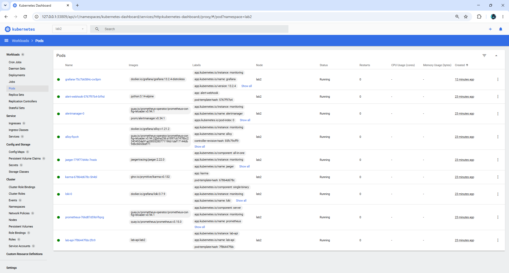

P.S. на некоторых скриншотах можно увидеть 31 октября. Это местное время +2. Надо смотреть на время коммита - 30 октября.

## Часть 0 — Свой сервис
Добавили недостающие эндпоинты: `/fail`, `/slow`, `/load`. Эндпоинт `/load` конкурентно дёргает 90 раз `/health`, 5 раз `/slow` и 5 раз `/fail`. `/slow` отвечает с задержкой от 1000 до 3000 мс. В `/fail` выбрасывается исключение, из-за которого API возвращает HTTP 500 (не груз, а HTTP-код).

В первой лабе уже был middleware (штука, которая встраивается в пайплайн обработки запроса, в ней можно реализовать логику перед и после обработки запроса), который писал в лог инфу о запросах. Немного его поменяли.

Добавили ещё один middleware, который пишет метрики (пишет в память апи) через готовую [либу](https://www.nuget.org/packages/prometheus-net/). Либа за нас реализует ручку /metrics.

Для otel тоже использовали готовую [либу](https://www.nuget.org/packages/opentelemetry/).

## Часть 1 — Метрики (Prometheus + Grafana)

Прометей дёргает /metrics раз в 5 сек. Графана использует прометея как источник данных.

Открываем графану с дашбордом по RED. Пока никакие запросы не шлём.

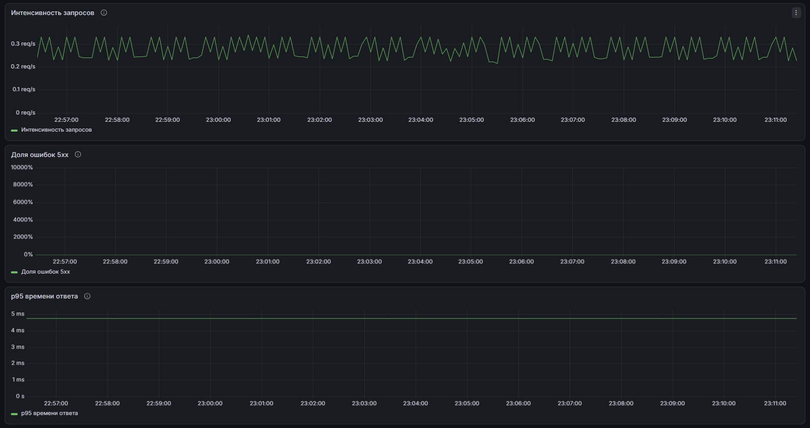

Видим долю ошибок 0%, оценку p95 времени ответа около 5 мс и интенсивность 0,2–0,3 запроса в секунду. Откуда запросы, мы же ничего не шлём? Мы нет, а вот кубер — да:

* readinessProbe вызывает /health каждые 5 секунд;
* livenessProbe вызывает /health каждые 10 секунд.

Теперь подёргаем load, slow, fail.

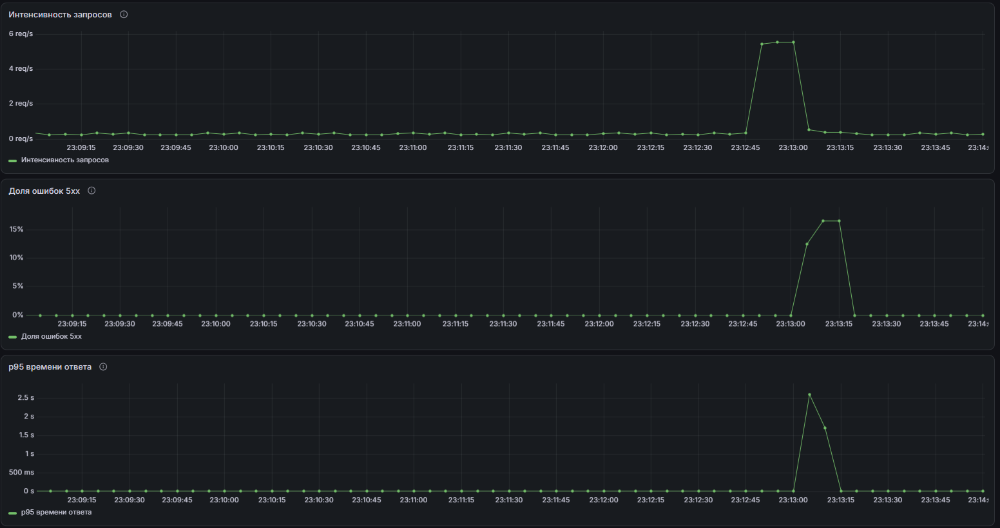

Видим, что графики бодро зашевелились. В моменте интенсивность выросла примерно до 5,5 rps, доля ошибок достигла примерно 16%, p95 вырос примерно до 2,6 сек. 

## Часть 2 — Логи (Loki + Grafana)

API пишет структурированные JSON-логи в консоль. Их собирает и отправляет в хранилище Loki агент Alloy, который развёрнут через DaemonSet и собирает логи Pod API на своей ноде. Сам Loki логи не собирает. Локи подключён к графане как источник данных.

Дёргаем /fail и находим ошибку в логах.

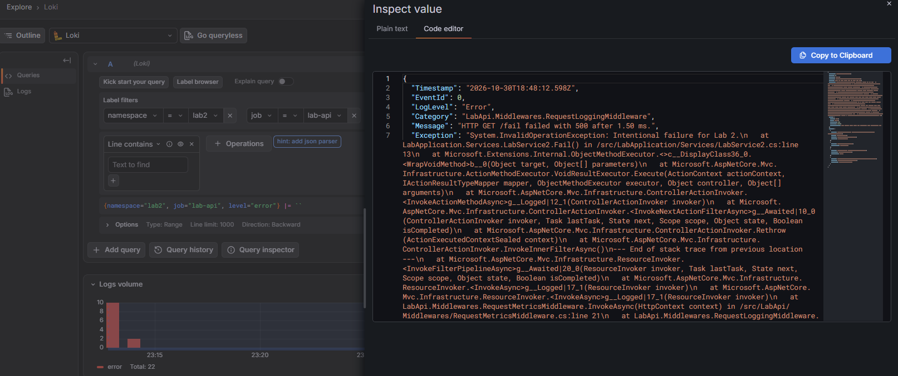

## Часть 3 — Трейсы (OpenTelemetry + Jaeger)

Подняли Jaeger одним экземпляром и настроили отправку трейсов из API через OpenTelemetry. Адрес получателя задали переменной OTEL_EXPORTER_OTLP_ENDPOINT. 

Шлём /slow и /fail, находим в логах эти запросы, берём у них trace_id, открываем джагер и находим наши запросы по их trace_id.

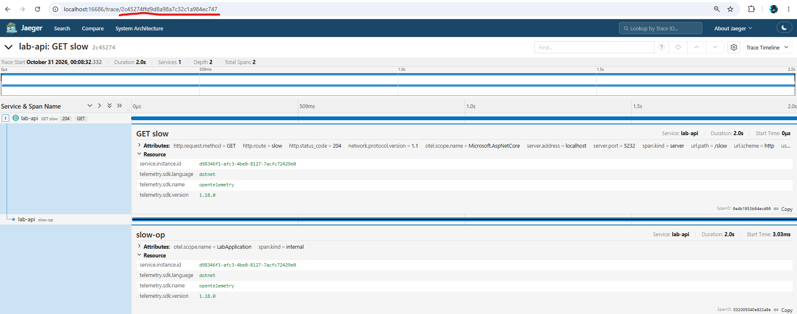

У `/slow` виден вложенный спан `slow-op` длительностью около 2 секунд: почти всё время запроса ушло на эту операцию.

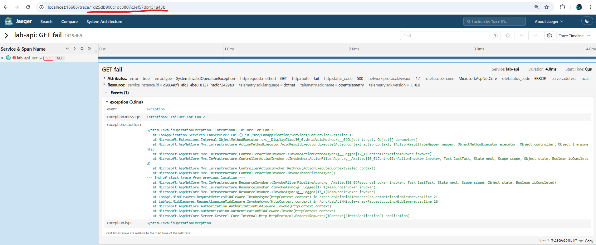

У `/fail` видны HTTP 500, статус спана `ERROR` и событие с исключением.

Также можем отдельно посмотреть трейсы с ошибкой по фильтру `error=true`, а среди найденных трейсов выделить долгие запросы `/slow`.

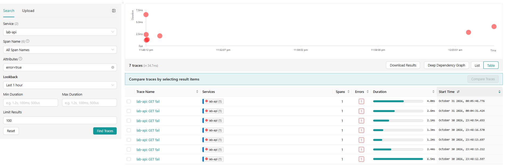

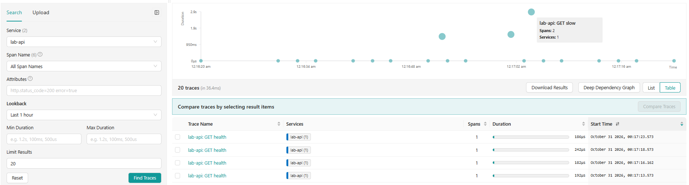

## Часть 4 — Алерты (Alertmanager + Karma)

Правила на PromQL проверяет Prometheus. Сработавшие алерты он передаёт в Alertmanager, который группирует их и отправляет уведомления получателю. Karma читает состояние алертов из Alertmanager и показывает их в одном интерфейсе.

Придумали три критичных алерта:

* `ApiUnavailable` — Prometheus не получает метрики API больше минуты: сервис может быть недоступен. Проверяем Pod, Service и сеть.
* `ApiHighErrorRate` — доля ответов 5xx за последние 5 минут превышает 10% в течение 3 минут подряд. Пользователи получают ошибки; смотрим логи в Loki и трейсы в Jaeger.
* `ApiHighLatency` — p95 времени ответа за последние 5 минут превышает 2 секунды в течение 3 минут подряд. Пользователи долго ждут ответ; проверяем медленные трейсы, ресурсы и зависимости API.

Для двух последних алертов требуется минимум 20 запросов за пятиминутное окно, `/health` исключён из расчёта.

Чтобы получить два последних алерта, в течение 5 минут шлём `/slow` и `/fail`.

```bash
end=$((SECONDS + 300))
while (( SECONDS < end )); do
    curl -sS -o /dev/null http://localhost:5232/fail &
    curl -sS -o /dev/null http://localhost:5232/slow &
    wait
    sleep 1
done
```

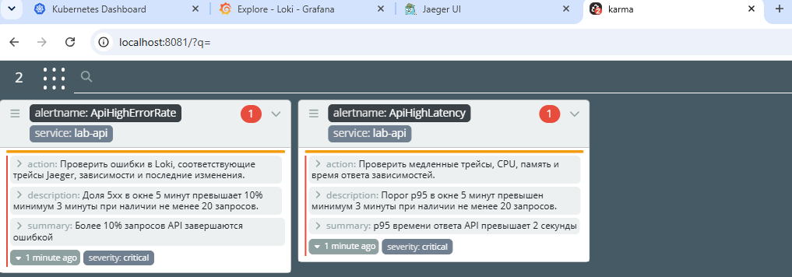

Оба алерта перешли в состояние `firing` и появились в Karma.

Затем, чтобы вызвать первый алерт, говорим куберу, что нам нужно 0 реплик апи.

```bash
minikube -p lab2 kubectl -- --context lab2 -n lab2 \
    scale deployment/lab-api --replicas=0
```

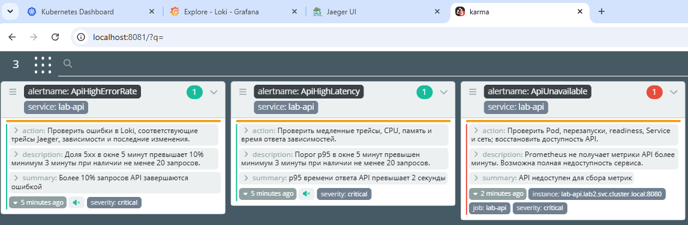

Сработал `ApiUnavailable`. При недоступности API Alertmanager подавляет уведомления по двум другим алертам того же сервиса - это видно по значкам в Karma.

Выше были показаны алерты в Карме. Ниже `ApiUnavailable` в Alertmanager.

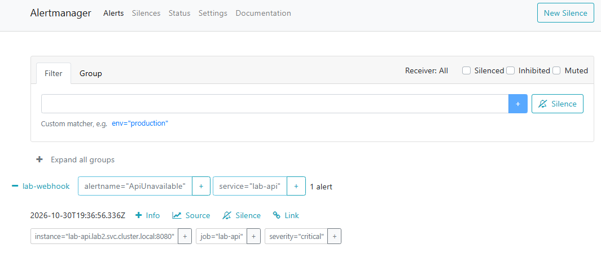

В качестве получателя уведомлений выбрали свой webhook. Alertmanager отправляет ему `POST /alerts` с JSON, а webhook сохраняет последние уведомления в памяти и пишет их в консоль. В логах видны полученные уведомления со статусом `firing` для `ApiHighErrorRate` и `ApiHighLatency`.

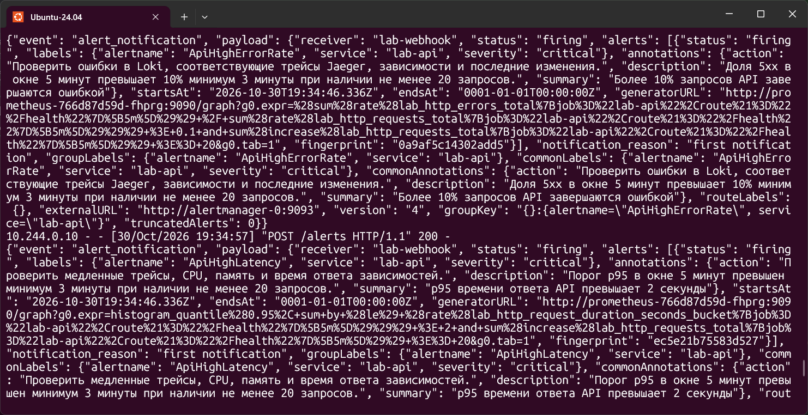


